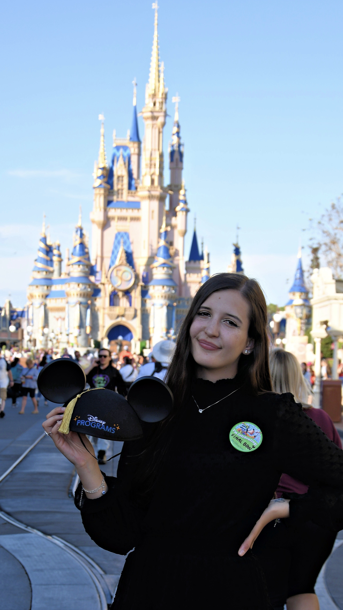

# amandabeatriz-passos.github.io

### Hi! Welcome to my GitHub page!

I'm **Amanda**, a Brazilian student currently pursuing a Master's degree in [**Public and Corporate Communication**](https://www.unimi.it/en/education/master-programme/public-and-corporate-communication-com) in Milan, Italy.

I have a Bachelor's degree in Organizational Communication and experience in corporate communication, cultural projects and event production. Throughout my career, I've had the opportunity to work with organizations such as **Volvo, FIMS, Festival de Curitiba, Fiep and Walt Disney World**, where I participated in the Disney Cultural Exchange Program.

Outside of work and studies, I'm passionate about **music, culture and entertainment**. I love going to concerts, discovering new artists and experiencing live music.

Some of my favourite artists and bands are [Justin Bieber](https://www.instagram.com/lilbieber/), [Twenty One Pilots](https://www.instagram.com/twentyonepilots/), [Jão](https://www.instagram.com/jao/?hl=pt) and [Jovem Dionisio](https://www.instagram.com/jovemdionisio/).

Welcome to my page! :)
